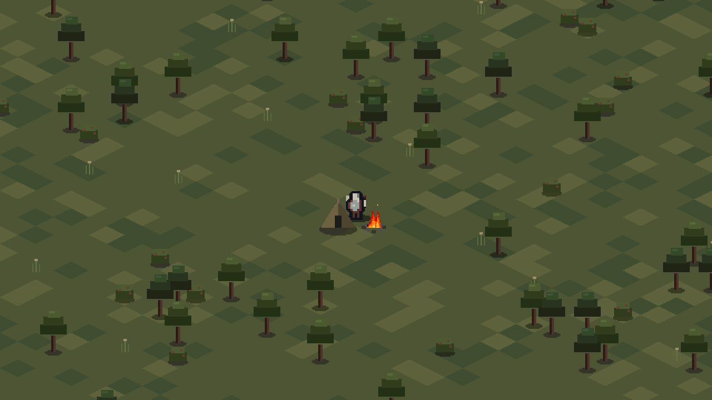
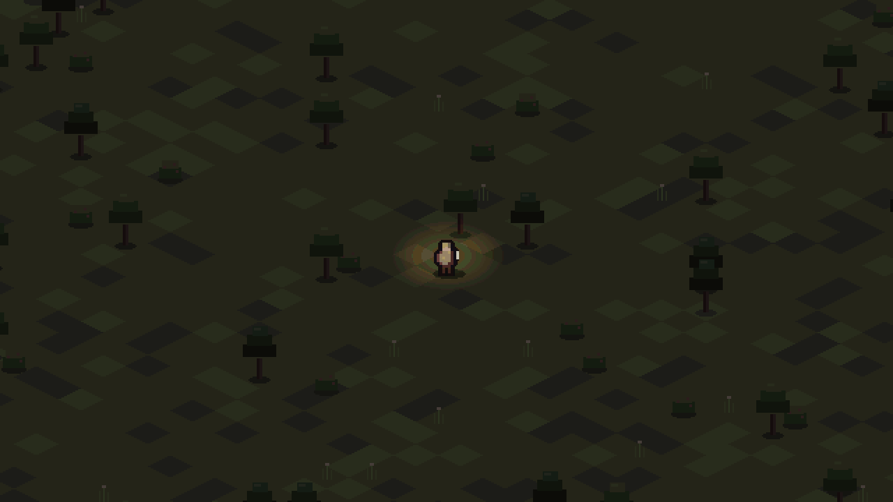
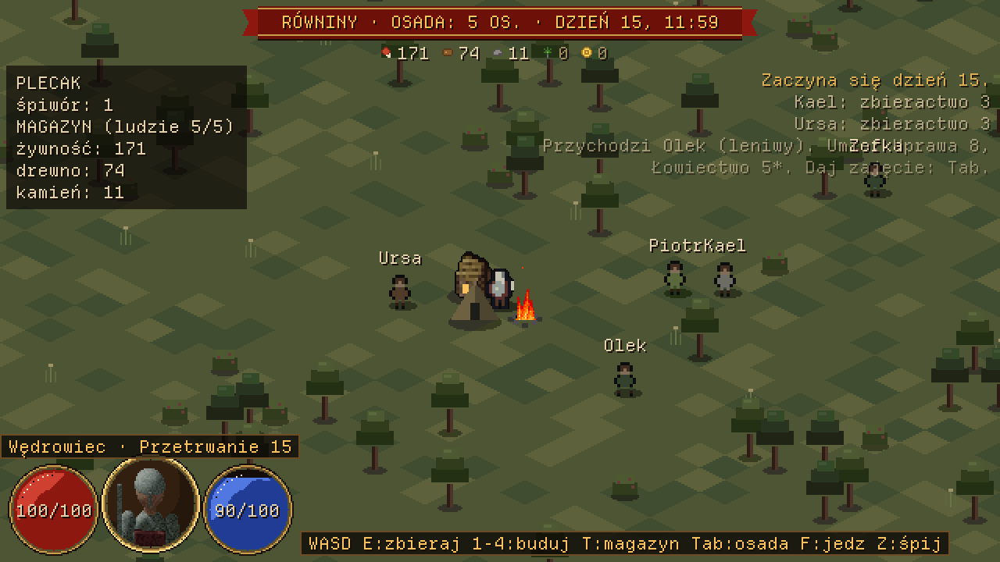
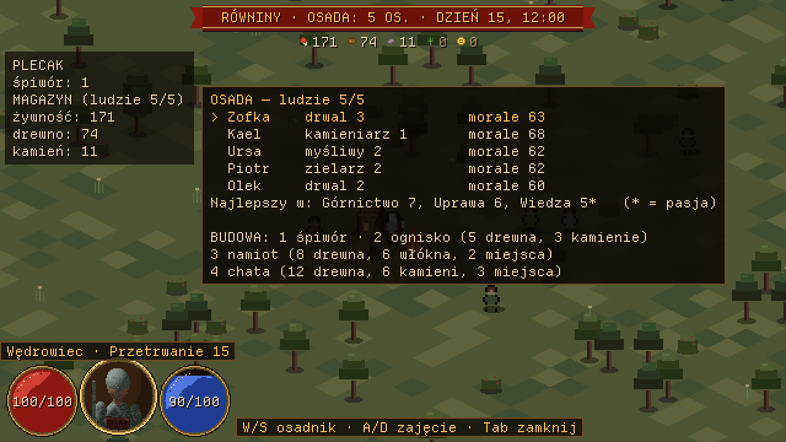
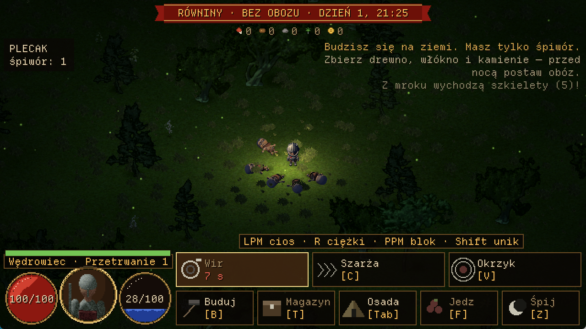
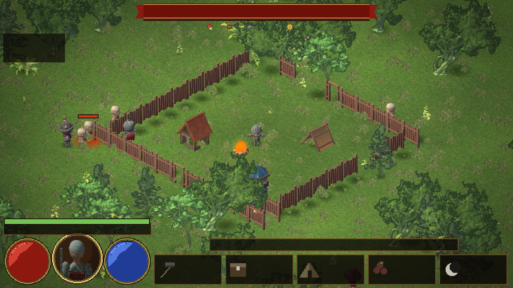

# Zomboid fantasy — tryb przetrwania w czasie rzeczywistym (Unity)

Drugi tryb gry, obok fabularnej gry turowej: **wielki świat z kafli, bohater chodzi swobodnie, zaczyna bez
niczego i ze śpiworem**, zbiera zasoby, stawia ognisko i namiot, a potem zakłada osadę i nią zarządza.
Wybierasz go w menu głównym: **[2] Przetrwanie — świat w czasie rzeczywistym**.

## Sterowanie
| Klawisz | Co robi |
|---|---|
| WASD albo strzałki | ruch względem ekranu (w rzucie skośnym to przekątne siatki), ślizg wzdłuż przeszkód |
| E albo spacja (przytrzymaj) | zbieraj to, co jest przed bohaterem: ścinaj drzewa, łup skały, zrywaj jagody i zioła |
| B albo kafelek Buduj | tryb budowania z zakładkami Obóz, Obrona, Zakłady i Rzemiosło; duch na mapie pokazuje miejsce (zielony: wolno, czerwony: nie). Koszty są w sekcji o budowie etapami |
| E przy placu albo zakładzie (trzymaj) | pracuj przy budowie albo przy zleceniu |
| lewy klik / Enter | postaw wybraną budowlę pod kursorem, do 6 kafli od bohatera; palisadę można stawiać przeciągnięciem |
| prawy klik / Esc | wycofaj wybór, potem wyjdź z trybu albo zamknij panel |
| T albo kafelek Magazyn | odłóż plecak do magazynu (przy obozie) |
| Tab albo kafelek Osada | panel osady: klik w osadnika, potem kafelek zajęcia i plan doby (W/S i A/D też działają) |
| lewy klik albo J | lekki cios w stronę kursora |
| R albo K | ciężki cios: wolny, ale mocny i przerywa nawet wojownika |
| prawy klik (trzymaj) albo L | blok; wciśnięty tuż przed trafieniem to parowanie |
| Shift | unik z chwilą nietykalności |
| Q / C / V albo kafelki (tylko nocą) | ciosy specjalne: wir, szarża, okrzyk |
| G albo kafelek Przybysz | karta wędrowca czekającego przy ognisku: przyjmij albo odpraw |
| F | zjedz jagody |
| Z | śpij (przy śpiworze albo namiocie; czas płynie 40× szybciej, w namiocie regeneracja jest szybsza) |
| Esc (gdy nic nie jest otwarte) | powrót do menu głównego |

## Faza 1: przetrwanie (zrobione)
- **Świat 2001×2001 kafli**, generowany z ziarna, bez zapisanych danych (`Logika/Wolny/GeneratorSwiata.cs`):
  biomy z szumu na współrzędnych świata (wzorzec z Project Zomboid, patrz `PROJECT-ZOMBOID-ANALIZA.md`) z rozmytymi,
  nieregularnymi granicami; woda w bagnach, ściany w ruinach, drzewa, skały, krzaki z jagodami, zioła.
  Polana startowa 9×9 jest pusta. Poza granicą — nieprzebyta mgła.
- **Ruch z kolizjami** na kaflach, prędkość 3,4 kafla/s, osie osobno (ślizg).
- **Zbieranie**: każde użycie trwa 0,9 s, drzewa i skały mają 3 użycia, krzaki i zioła odrastają po 2–3 dobach.
- **Potrzeby**: głód (jagody), zmęczenie (sen), życie; doba trwa 8 minut, noc jest ciemna, światło mają ognisko i latarnia.
- **Obóz**: po postawieniu namiotu i ogniska gra ogłasza, że obóz stoi.
- **Scena** izometryczna 32×16 px z drzewami, skałami, wodą, namiotem, ogniskiem; interfejs fantasy (pasek stanu, plecak,
  dziennik, podpowiedź).

## Faza 2: osada (zrobione)

- **Przybysze:** gdy stoją namiot i ognisko, o północy przychodzi pierwszy człowiek, potem kolejni (40% dziennie), o ile jest miejsce. Namiot daje 2 miejsca, **chata** (kafelek w trybie budowania: 12 drewna, 6 kamieni) 3.
- **Magazyn:** T przy obozie odkłada drewno, kamień, zioła i jagody (jako żywność). Budowanie bierze najpierw z plecaka, potem z magazynu; F przy obozie je z zapasów, gdy plecak jest pusty. Włókno zostaje w plecaku.
- **Zarządzanie:** Tab otwiera panel: klik wybiera osadnika, kafelek ustawia zajęcie (bez zajęcia, drwal, kamieniarz, zielarz, myśliwy, górnik). Świat w tym czasie płynie dalej.
- **Gospodarka:** ten sam `Osada.DzienOsady` co w grze fabularnej, raz na dobę: produkcja do magazynu, jedzenie, opał zimą, morale, choroby, umiejętności i pasje. Bez jedzenia ludzie głodują i odchodzą.
- **Życie na mapie:** osadnicy idą trasą po kaflach (BFS omija przeszkody) do drzewa, skały, ziół lub krzaka właściwego dla zawodu, kręcą się przy pracy, a nocą śpią przy budowlach. Nad głowami mają imiona.

Świadome uproszczenia: praca osadników nie zużywa drzew i skał na mapie (produkcja idzie wprost do magazynu), chata stawia się od razu (bez rusztowań i budowniczych), skryptorium i budynki z gry fabularnej nie są jeszcze w tym trybie, a więzi i myśli są nieaktywne jak w całym porcie.

## Faza 3: walka (zrobione)

- **W dzień jak w Souls:** każdy cios i unik zużywa wytrzymałość (zielony pasek nad imieniem), a poniżej 6 punktów trzeba złapać oddech. Wrogów jest mało, najwyżej dwóch włóczęgów, ale każdy groźny: wojownik ma 120 życia i bije za 28.
- **Blok, parowanie, riposta:** blok działa tylko od przodu i płaci wytrzymałością, a gdy jej zabraknie, garda pęka. Wciśnięcie bloku w ostatnich 0,2 s przed trafieniem to parowanie: ogłusza napastnika i przez 1,3 s następny cios rani 2,6 razy mocniej.
- **Zapowiedzi:** przed ciosem pod wrogiem rośnie czerwona plama, więc jest czas na reakcję. Naraz uderza najwyżej dwóch.
- **W nocy tłumy:** od 21:00 do 5:00 co 1,5 godziny gry fala rusza z mroku na obóz, a jeśli bohater jest blisko albo obozu nie ma, na niego. Każda doba daje większą falę, a od drugiej dochodzą łotrzyki i magowie z pociskami, od czwartej wojownicy. Na scenie jest najwyżej 14 wrogów. Fala budzi śpiącego, a z wrogiem w pobliżu nie da się zasnąć.
- **Ciosy specjalne:** budzą się tylko nocą i działają na czas odnowienia: wir (dookoła, 8 s), szarża (przez wrogów, 10 s), okrzyk (ogłusza wszystkich blisko, 16 s).
- **Osada w ogniu:** szkielety niszczą budowle i zabijają osadników. O świcie reszta się rozsypuje, a budowle wracają do pełnej wytrzymałości.
- **Śmierć:** pobudka w obozie, przy śpiworze albo na polanie startowej. Plecak zostaje na ziemi, trzeba po niego wrócić i podnieść go klawiszem E.

Świadome uproszczenia: za zabijanie nie ma nagród ani rozwoju, osadnicy się nie bronią, a broń bohatera nie zmienia ciosów. Liczby balansu sprawdziły testy, ale nikt jeszcze nie ocenił ich w dłuższej grze.

## Faza 4: obrona i zapis (zrobione)

- **Palisada i brama:** palisada zatrzymuje wszystkich. Przez bramę przechodzą bohater i osadnicy, a szkielety nie. Szkielet, któremu mur stanie na drodze, zaczyna go burzyć (palisada 90 życia, brama 70).
- **Wieża:** strzela sama do najbliższego wroga w zasięgu 7,5 kafla, 14 obrażeń co 1,1 s. Ma 160 życia.
- **Strażnik:** nowe zajęcie w panelu osady. Ma dwa razy więcej życia (90 zamiast 45), a wroga w zasięgu 12 kafli atakuje sam (13 obrażeń co 1,1 s), także w dzień. Nie zbiera surowców, a chory nie walczy.
- **O świcie:** ocalałe budowle i ludzie wracają do pełnego życia. Zniszczone budowle trzeba postawić od nowa.
- **Zapis:** gra zapisuje się o świcie, przy wyjściu do menu i przy zamknięciu okna. W menu pojawia się **[3] Kontynuuj przetrwanie**, a **[2]** zaczyna nowy świat i przy pierwszym zapisie zastępuje stary. Poprzedni zapis zostaje jako kopia i wraca, gdy główny plik jest uszkodzony.
- **Co jest w zapisie:** świat, potrzeby, plecak, budowle i ich rany, ścięte drzewa, magazyn, osadnicy z umiejętnościami, wrogowie i porzucone plecaki. Plik leży w `%USERPROFILE%\AppData\LocalLow\DefaultCompany\GraSimply\przetrwanie.txt`.

Świadome uproszczenia: szkielety nie szukają bramy ani dziury w murze, tylko idą prosto i burzą to, co stoi na drodze. Strażnicy nie dostają rozkazów. Czas odnowienia ciosów specjalnych, trwające ciosy i dokładne trasy osadników nie są zapisywane.

## Faza 5: harmonogram i przybysze (zrobione)

- **Plan doby:** każdy osadnik ma cztery części doby (rano 5–11, dzień 11–17, wieczór 17–21, noc 21–5), a w każdej pracę, sen, czas wolny albo straż. Klik w kafelek zmienia część, a „Plan dla wszystkich” kopiuje plan na całą osadę.
- **Skutki planu:** dwie części pracy to pełny plon, mniej to szansa na pracę tego dnia, a trzecia i czwarta dają dodatkowy plon. Praca i straż męczą, sen zdejmuje zmęczenie, a czas wolny poprawia morale. Przy dużym zmęczeniu wydajność spada o połowę, morale leci, a osadnik może paść z przepracowania.
- **Warta:** osadnik w części „straż” walczy, ale słabiej niż strażnik i bez zbroi. Śpiący strażnik zrywa się dopiero, gdy wróg jest tuż obok, więc nocną wartę trzeba zaplanować.
- **Przybysze:** w tym trybie nikt nie wprowadza się sam. O świcie przy ognisku może stanąć wędrowiec i czeka do 20:00. Karta pokazuje umiejętności, cechę, wrażenie i cenę, a Ty przyjmujesz albo odprawiasz. Lepsza renoma osady oznacza więcej chętnych i wybór lepszych ludzi.
- **Ukryte ryzyko:** część przybyszów ma sekret. Wrażenie bywa trafne, ale myli w obie strony: zdrajca może wyglądać zwyczajnie, a uczciwy blado.
  - **Choroba:** po kilku dniach osadnik dostaje gorączki i może zarazić innych.
  - **Sabotaż:** spalone zapasy albo wyłamany mur, bez podpisu. Ślad oznacza kogoś znakiem „?”, ale czasem niewinnego.
  - **Zdrada:** po kilku dniach osadnik ucieka z częścią zapasów i zostawia dziurę w murze.
- **Wypędzenie:** kafelek w panelu. Gra nie mówi, czy miałeś rację, a wypędzenie niewinnego mocniej uderza w morale.

Świadome uproszczenia: choroba i zmęczenie nie mają leczenia poza snem i tym, co liczy `Osada.DzienOsady`. Pełne zasady działają w tym trybie, a gra fabularna ma swoje zasady bez zmian.

## Faza 6: budowa etapami i warsztaty (zrobione)

- **Budowa etapami:** śpiwór i ognisko stają od razu, a reszta zaczyna się od placu budowy. Materiały etapu schodzą z plecaka, magazynu i wyrobów, gdy zaczyna się praca. Bez nich etap stoi, a gra mówi, czego brakuje. Na mapie widać deski, potem rusztowanie, potem niski budynek.
- **Zespół:** pracuje bohater (trzyma E, do 2,2 kafla od placu) i osadnicy z zawodem budowniczy, gdy plan doby mówi „praca”. Pierwsza osoba daje pełną siłę, a każda kolejna 75% poprzedniej, do tego umiejętność Budowa i młotek bohatera.
- **Szkielety:** niedokończony plac ma 50 życia, a po jego zniszczeniu materiały przepadają.

| Budowla | Etapy i materiały | Czas jednej osoby |
|---|---|---|
| Namiot | szkielet 30 drewna, płótno 20 włókna | 50 s |
| Chata | fundament 40 kamieni, ściany 25 belek, dach 30 desek | 240 s (pół doby) |
| Palisada | 8 drewna na kafel | 6 s |
| Brama | 25 drewna | 15 s |
| Wieża | podstawa 40 kamieni, konstrukcja 15 belek, platforma 15 desek i 2 liny | 140 s |
| Warsztat | fundament 15 kamieni, konstrukcja 40 drewna, stoły 15 drewna | 90 s |
| Tartak | fundament 20 kamieni, konstrukcja 60 drewna, piła 20 drewna i 5 kamieni | 110 s |
| Kuźnia | palenisko 50 kamieni, ściany 12 belek, komin 20 kamieni | 150 s |

- **Warsztaty i zlecenia:** zakładka Rzemiosło pokazuje przepisy, a klik dopisuje zlecenie do kolejki zakładu (do 8). Materiał schodzi, gdy zaczyna się praca. Wykonuje je bohater stojący przy zakładzie albo osadnik z zawodem rzemieślnik, zgodnie z planem doby.

| Zakład | Przepis |
|---|---|
| Tartak | deski (3 drewna daje 2), belka (4 drewna) |
| Warsztat | lina (3 włókna), młotek, siekiera, kilof |
| Kuźnia | miecz, zbroja (ruda od górnika) |

- **Narzędzia:** działają od razu i na stałe. Siekiera i kilof przyspieszają zbieranie o połowę, młotek budowę o 30%, miecz daje 35% więcej obrażeń, a zbroja o 25% mniej ran.

Świadome uproszczenia: nie ma noszenia materiałów, narzędzia się nie zużywają, działają tylko na bohatera, a osadnicy biorą materiały z każdej odległości.

## Faza 7: cele dla gracza i symulacja balansu (zrobione)

- **Cele:** plakietka nad podpowiedzią na dole ekranu prowadzi przez 11 celów: ognisko, namiot, pierwsza noc, przybysz, palisada, tartak. Cel wynika ze stanu świata, więc nie trafia do zapisu, a po zniszczeniu namiotu gra sama wraca do celu „postaw namiot”. Głód, zmęczenie i porzucony plecak wchodzą przed kolejkę.
- **Bot:** `unity/Testy/BotWolny.cs` gra wyłącznie przez `Wejscie` i słucha tych samych celów co gracz. Ma trzy profile: sprawny, przeciętny i początkujący.
- **Raport:** `cd unity/Testy && dotnet run -- --symulacja 40 4` (światów, dni).

Wyniki na 40 światach, 4 dni, 6.11.2026. To boty, a nie ludzie, więc liczby służą do porównywania wersji. Obecne zasady:

| | Sprawny | Przeciętny | Początkujący |
|---|---|---|---|
| Namiot przed pierwszą nocą | 40/40 | 40/40 | 40/40 |
| Namiot gotowy (mediana, noc o 280 s) | 133 s | 157 s | 213 s |
| Noc 1 bez śmierci | 24/40 | 31/40 | 23/40 |
| Obóz stoi po nocy 1 | 27/40 | 27/40 | 24/40 |
| Obóz stoi po nocy 2 | 18/40 | 23/40 | 20/40 |

**Decyzja balansu (wariant B):** nocny szkielet woli bohatera od budowli z 16 kafli (`ZasiegUwagi`), a nie z 8. Wcześniej obóz stał po nocy 1 tylko w 4/40 rozgrywek w każdym profilu i padał około 00:30, choć fala 5 szkieletów kosztuje bota tylko około 7 życia. Teraz kto stoi przy obozie, ten go broni, a kto odejdzie dalej, ten go traci.

Odrzucone warianty (bot przeciętny, obóz po nocy 1 i po nocy 2): mocniejsze budynki 8 i 1, lżejsza noc 1 6 i 1, mocniejsze budynki razem z B 32 i 29 (obóz stał prawie zawsze).

Ograniczenie: bot nie stawia zamkniętego pierścienia palisady ani wież, więc noce 2 i dalsze są zaniżone. Sprawny bot wypada w nocy 1 gorzej od przeciętnego (24/40 i 31/40 bez śmierci); przyczyny nie badałem, więc profile nadają się do porównywania wersji balansu, a nie poziomu gracza.

## Faza 8: interfejs 1280×720 z panelem bocznym (zrobione)

- **Rozdzielczość:** nakładka przetrwania (`PulpitWolny`) rysuje się wprost w 1280×720, a nie w 640×360 powiększanym dwa razy. Menu, obóz fabularny i mapa zostają na starej siatce.
- **Dolny pasek:** niskie kafelki z ikoną i klawiszem. Nazwę pokazuje podpowiedź, gdy kursor stoi nad kafelkiem. Ciosy specjalne wchodzą nocą rząd wyżej.
- **Panel boczny:** budowa, rzemiosło, osada i przybysz otwierają się po prawej stronie na całą wysokość ekranu. Bohater stoi na środku, więc mapa wokół niego zostaje widoczna. Koszty są pokazane w całości.
- **Klawisze i identyfikatory kafelków** się nie zmieniły.

## Faza 9: droga do miasta, etap 1 (zrobione, balans do decyzji)

- **Szczeble:** obóz, wioska (4 ludzi, farma, chata), miasteczko (12 ludzi, spichlerz, tawerna), miasto (30 ludzi, lecznica, targ, 200 zł). Awans jest automatyczny i nie cofa się. Liczba 30 to założenie, stała `LudziNaMiasto`.
- **Nowe budynki** (zakładka Zakłady): farma od początku, spichlerz i tawerna od wioski, lecznica i targ od miasteczka. Każdy budynek na mapie to jeden poziom w `Osada.DzienOsady`, więc działają jak w Nowej grze: jedzenie, wolniejsze psucie zapasów, morale, leczenie, handel.
- **Nowe zawody:** rolnik, uzdrowiciel i handlarz pojawiają się w panelu, gdy stoi ich budynek.
- **Cele:** kolejka ma teraz 20 pozycji, aż do miasta. Porzucony plecak jest pilny tylko za dnia i gdy stoi obóz. Podpowiedź o jedzeniu odróżnia jedzenie pod ręką od zapasów w odległym obozie.
- **Uproszczenie:** utrzymanie budynków jest na razie darmowe, a złoto służy tylko do awansu na miasto.
- **Naprawiony błąd:** od fazy 6 tartaku, warsztatu i kuźni nie dało się postawić, bo `PostawNa` odrzucało budowle spoza starej tabeli kosztów. Test przechodzi teraz przez kafelek i klik dla każdej budowli.
- **Przebieg rozgrywki:** `cd unity/Testy && dotnet run -- --przebieg 1000 30 0` (świat, dni, profil 0-2).

**Stan balansu (20 światów, 30 dni, próby bez zmian w grze).** Obecne zasady nie utrzymują osady: wioski nie osiąga żaden bot. Kolumny ze zgonami i obozem dotyczą bota przeciętnego:

| Wariant | Zgony w nocy 10 | Obóz stoi po nocy 10 | Obóz stoi po nocy 29 | Wioska (sprawny, przeciętny, początkujący) |
|---|---|---|---|---|
| Stan obecny | 6,1 | 3/20 | 1/20 | 0, 0, 0 |
| 1. Zagrożenie według wielkości osady, fale co 3 h | 0,8 | 13/20 | 6/20 | 3, 1, 0 |
| 2. Jak 1, a szkielety nie niszczą placów | 0,8 | 11/20 | 4/20 | 6, 0, 0 |
| 3. Jak 2, a przed wioską za dnia bez wojowników | 1,0 | 12/20 | 7/20 | 3, 1, 0 |

**Wprowadzony wariant 1:** budżet fali to 3 + osadnicy + budowle/3 + 2 × szczebel, a fale idą co 3 godziny gry. Dni decydują już tylko o typach szkieletów. Różnice między wariantami 1, 2 i 3 mieszczą się w szumie przy 20 światach, a bot nie stawia zamkniętej palisady ani wież, więc wynik jest zaniżony. Miasteczka nie osiągnął żaden bot w żadnym wariancie.

## Co dalej (jeszcze niezrobione)
0. Tryb miasta po szczeblu Miasto: M0 i M1 gotowe, dalej M2 (wózki, pierwszy łańcuch). Plan w `KONCEPT-TRYB-MIASTA.md`.
1. Kolejne budynki produkcyjne (pola, skryptorium z badaniami).
2. Nagrody i rozwój za walkę.
3. Narzędzia (siekiera, kilof), kupcy, drogi.
4. Punkty zainteresowania (ruiny, jaskinie, miasta) z istniejącego generatora regionów.

## Techniczne
`SwiatWolny.Aktualizuj(dt, Wejscie)` to czysta logika bez Unity (testy: `unity/Testy/TestyWolnego.cs`), `ScenaWolna` rysuje
stan, `SilnikGry` liczy klatkę na wątku głównym, a wątek logiki tylko czeka (`Gra.Przetrwanie_`).
Podgląd klatek: `cd unity/Testy && dotnet run -- --wolny <katalog>`.
Symulacja balansu: `cd unity/Testy && dotnet run -- --symulacja 40 4`.
