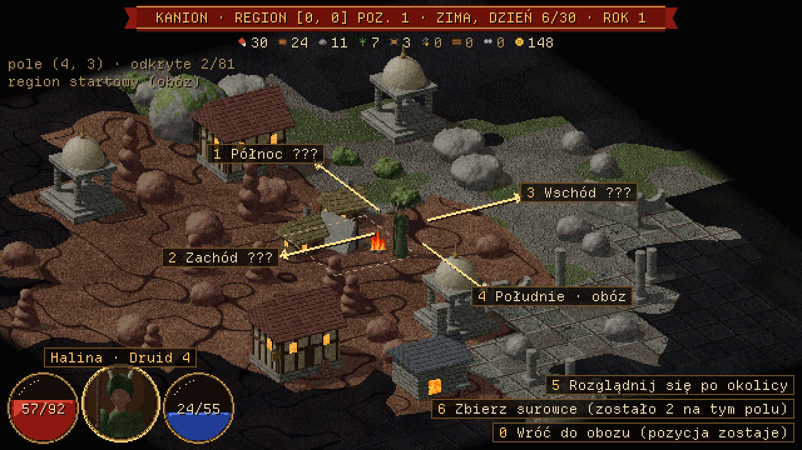
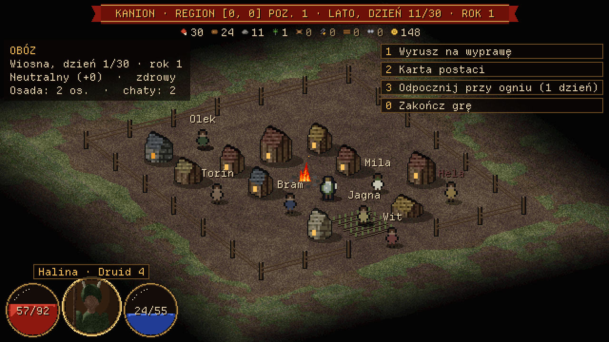
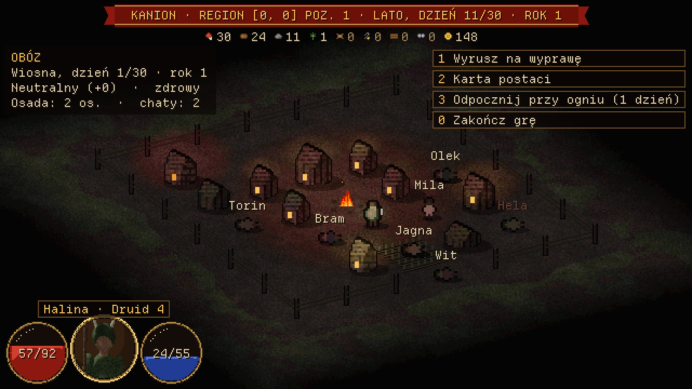
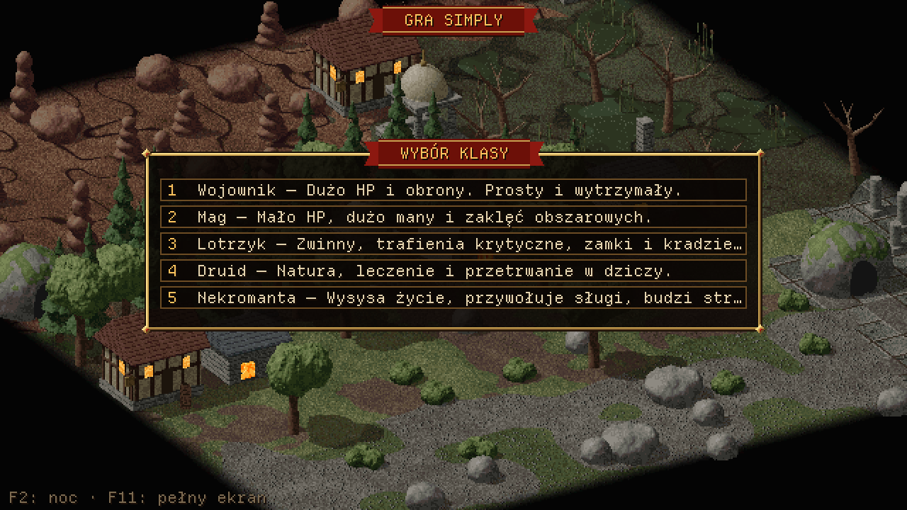
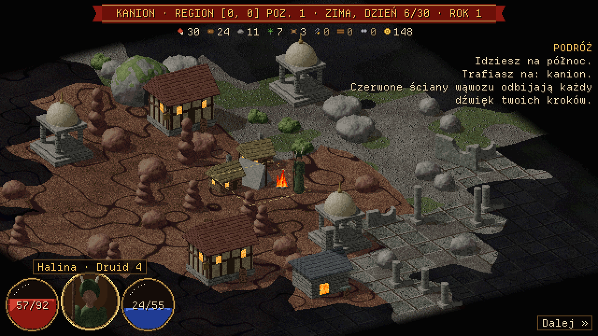
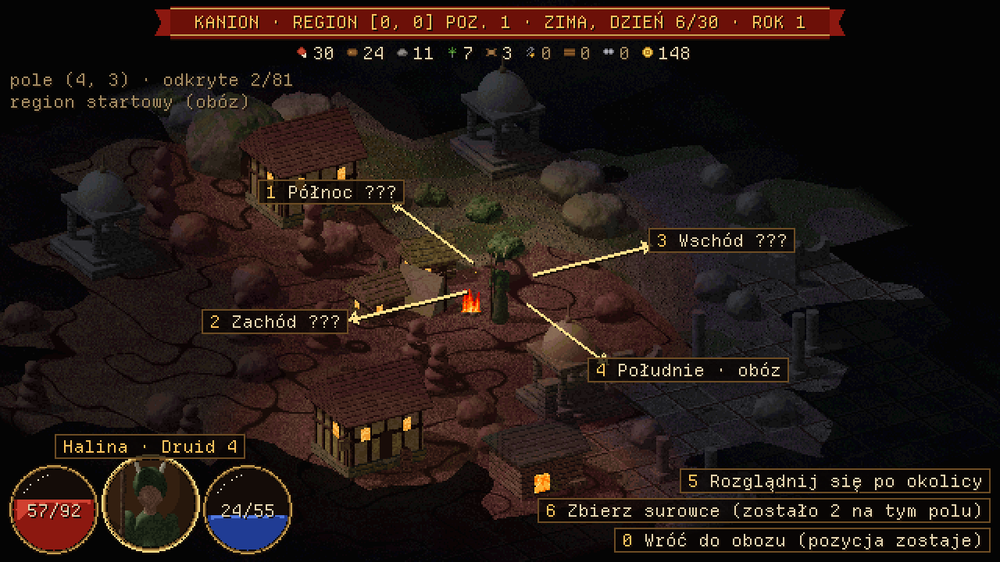
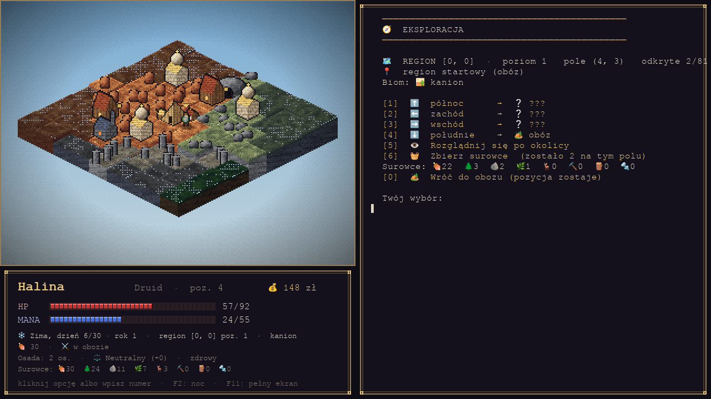

# Port na Unity

Przeniesienie gry z Pythona na Unity i C#. Wersja pythonowa w katalogu głównym
**zostaje nietknięta** — służy jako wzorzec, do którego port się porównuje,
i dalej jest grywalna (`python main.py`).



Gra ma trzy style grafiki, do wyboru w inspektorze komponentu *Silnik gry*
(pole **Styl grafiki**):

* **Hybrydowy** (domyślny) — pixelart i Mroczny w jednym obrazie: rzut skośny,
  ciągły grunt gasnący w czerń, noc ze światłem tylko ognia i okien, wspólna
  paleta i interfejs fantasy z Mrocznego, ale chaty, namiot i ludzie jako
  pixelart. Jedyny styl ze **sceną osady z bliska**, po której chodzą osadnicy
  (patrz niżej).
* **Mroczny** — mroczne fantasy w języku obrazu pierwszego
  Fallouta: ciągły grunt w rzucie skośnym, obiekty jako prerenderowane bryły
  z cieniem, noc rozjaśniana tylko przez ogień i okna, jedna wspólna paleta.
  Interfejs leży na mapie: strzałki ruchu wokół postaci, kule życia i many
  z portretem, gasnący dziennik zdarzeń, opcje jako złote plakietki
  (kliknij albo wpisz numer), a menu bez mapy w panelu na środku.
* **Klasyczny** — pixelart jeden do jednego z wersji pythonowej: mapa
  obok konsoli z tekstem.

Styl hybrydowy — plac osady w południe i w nocy:

| Południe | Noc |
| --- | --- |
|  |  |

| Wybór klasy (Mroczny) | Podróż, dziennik na mapie (Mroczny) | Noc (Mroczny) |
| --- | --- | --- |
|  |  |  |

Styl klasyczny:



## Jak to uruchomić

Potrzebne: Unity (2021.3 albo nowszy; starczy zwykły szablon 3D albo 2D).

1. **Unity Hub → Add → Add project from disk → wskaż katalog `unity/GraSimply`.**
2. W edytorze otwórz scenę `Assets/Scenes/Gra.unity` i naciśnij **Play**.

Nie zakładaj nowego projektu — `unity/GraSimply` **jest** projektem. Resztę
ustawień (`ProjectSettings/*.asset`, `Packages/manifest.json`) Unity dorobi
samo przy pierwszym otwarciu; w repozytorium jest tylko tyle, ile potrzebuje
Hub, żeby rozpoznać katalog.

Projekt deklaruje wersję **6000.6.0f1** (Unity 6) w
`ProjectSettings/ProjectVersion.txt`; działa też na 2022.3 i nowszych. Jeśli
masz inną, Hub zapyta, czy otworzyć swoją — zgódź się, to normalne
i bezpieczne. Żeby pytał rzadziej, wpisz tam swoją wersję (dokładnie tak,
jak pokazuje ją Hub):

```
m_EditorVersion: 6000.6.0f1
```

Gra czyta klawiaturę starym `Input`. Gdyby Unity zgłaszało błąd o *Input
System*, ustaw **Edit → Project Settings → Player → Active Input Handling**
na **Both**.

Jeśli scena nie chce się otworzyć (zdarza się przy dużej różnicy wersji
edytora), użyj menu **Gra Simply → Utwórz scenę gry** — zapisze świeżą scenę
tym Unity, które masz, i doda ją do ustawień budowania.

### Zwykła gra, bez Unity

Żeby grać jak w każdą inną grę — podwójne kliknięcie i okno z grą, bez Huba,
bez edytora, bez czekania na import — zbuduj paczkę:

**Gra Simply → Zbuduj grę (Windows)**

Gotowa gra ląduje w `Build/Windows/GraSimply.exe` (~92 MB, budowanie trwało
u nas 88 s). Tę paczkę odpalasz już bez Unity i możesz ją przenieść na inny
komputer z Windows — Unity nie jest tam potrzebne. Katalog `Build/` nie wchodzi
do repozytorium: odtwarza się z kodu jednym kliknięciem.

Edytora potrzebujesz więc tylko wtedy, gdy zmieniasz grę. Samo granie go nie
wymaga.

### Sterowanie

| Klawisz | Działa |
| --- | --- |
| cyfry + Enter | wybór opcji z menu |
| klik w opcję | to samo co wpisanie jej numeru |
| strzałki | ruch po mapie podczas wyprawy |
| spacja | zbadaj pole / potwierdź „naciśnij Enter” |
| kółko myszy | przewijanie konsoli |
| F2 | dzień / zmierzch |
| F11 | pełny ekran |

Gdyby zamiast ikon pokazały się puste prostokąty, wyłącz **Pokazuj emoji**
w inspektorze obiektu `Gra`. Tekst straci ikonki, ale zostanie czytelny.

## Jak to jest zbudowane

Trzy warstwy, każda w osobnej bibliotece (`asmdef`):

| Warstwa | Katalog | Zależności |
| --- | --- | --- |
| **Logika** | `Assets/Scripts/Logika` | brak — nie zna nawet UnityEngine |

### Co z zawartości jest już przeniesione

Walka turowa i bestiariusz (`combat.py` i `enemy.py` → `Walka.cs`, `Wrogowie.cs`):
obrażenia z trafieniem krytycznym, zapowiadane ruchy wroga (ciężki cios, ogień,
klątwa) z gardą i kontrą, ogień przerywający regenerację, szał bossa, trucizna,
krwawienie i ogłuszenie, uniki ze Zręczności, ucieczka, mikstury oraz nagrody
za wygraną. Wrogowie losują się tak samo jak w Pythonie — pilnuje tego
`unity/Testy` przez wzorce z `wrogowie.json`.

Czego w walce jeszcze nie ma: umiejętności klasowych (`skills.py`), przedmiotów
bojowych i łupów (`items.py`, `rzemioslo.py`), towarzyszy (`rekruci.py`), zadań
(`quests.py`) i cech pochodzenia (`pochodzenie.py`). Miejsca styku są oznaczone
komentarzem w `Walka.cs`.
| **Grafika** | `Assets/Scripts/Grafika` | tylko Logika; rysuje do bufora pikseli |
| **Gra** | `Assets/Scripts/Gra` | Unity; jeden `MonoBehaviour` spinający całość |

Logika i Grafika mają w pliku `asmdef` ustawione `noEngineReferences`, więc
**nie da się** w nich przypadkiem użyć Unity — kompilator na to nie pozwoli.
Dzięki temu obie warstwy budują się i testują zwykłym `dotnet`, bez edytora.

### Dwie decyzje, które warto znać

**Logika chodzi na osobnym wątku.** Wersja pythonowa była blokującym programem
konsolowym: `input()` zatrzymywał wykonanie, a okno pygame pompowało zdarzenia
od środka. W Unity nie wolno zablokować głównego wątku, bo stanęłoby rysowanie.
Zamiast przepisywać całą grę na maszynę stanów — co byłoby ogromną robotą
i rozjechałoby zachowanie — logika dostała własny wątek, a między nią
a rysowaniem stoi kolejka (`KonsolaKolejkowa`). Pętle w rodzaju
`while (true) { … Czytaj(); }` przeniosły się jeden do jednego.

**Rysowanie dostaje migawkę, nie żywy stan.** Wątek rysujący nigdy nie zagląda
do list i słowników postaci — logika zamraża je w `Migawka` tuż przed tym, jak
zablokuje się na pytaniu. Bez tego prędzej czy później trafiłby na słownik
w połowie zmiany, co w .NET kończy się wyjątkiem, a nie brzydką klatką.
Animacja (woda, ogień, chód) liczy się z czasu, więc obraz żyje między
migawkami.

**Pixelart jest liczony w kodzie, nie wczytywany z plików.** Tak jak w wersji
pythonowej: kafle, roślinność, budynki i sylwetki powstają z szumu, ramp
kolorów i ditheringu Bayera. Nie ma żadnych PNG-ów do trzymania, a `Pulpit`
składa całą klatkę 1280×720 i oddaje ją Unity jako jedną teksturę. Unity dokłada
tylko tekst. W stylu mrocznym bryły (drzewa, budowle, postacie) to modele 3D
z funkcji odległości, „fotografowane” raz w ustalonym świetle
(`Grafika/Mroczny/Fotograf.cs`) — tak powstawały sprite'y Fallouta.

**Tekst gry zostaje tekstem, interfejs go rozkłada.** Logika pisze do konsoli
jak w terminalu. Styl klasyczny pokazuje to jako konsolę; styl mroczny
(`PulpitFantasy`) rozkłada ekran na części (`EkranGry`): opcje ruchu stają się
strzałkami na mapie, pozostałe — przyciskami, narracja — dziennikiem. Emoji
zastępują pikselowe ikony surowców.

**Krój pisma.** Styl mroczny używa kroju pikselowego
[Departure Mono](https://departuremono.com) (Helena Zhang, SIL Open Font
License 1.1) z polskimi znakami — plik i licencja leżą w
`Assets/Resources/Kroje/`. Krój trzyma siatkę pikseli przy wielokrotnościach
11 px, dlatego napisy mają 22 px. Styl klasyczny bierze czcionki systemowe.

## Scena osady z bliska (styl hybrydowy)

Gdy gracz jest w menu obozu (`Ekran.Widok` = „oboz”), styl hybrydowy rysuje
plac osady zamiast mapy regionu: siatka 7×7, budynki na swoich miejscach,
chaty na wolnych polach, palisada z bramą, ognisko pośrodku i bohater obok.
Pozostałe style dalej pokazują mapę.

**Osadnicy naprawdę chodzą.** Ruch liczy `Logika/Ruch.cs` — port
`game/ruch.py`, bez UnityEngine: siatka, ścieżki A* (bez ścinania rogów),
rezerwacje pól (nikt nie stoi na jednym polu z drugim) i własne miejsce przy
celu, od frontu budynku. Doba sceny trwa 90 s i jest osobna od dnia świata:

| Pora | Co robią |
| --- | --- |
| rano | idą do stanowisk (kto przy czym pracuje — jak w wersji pythonowej) |
| praca | stoją przy warsztacie i kołyszą się w rytmie pracy |
| wieczór | siadają przy ognisku albo idą do tawerny (stały wybór dla imienia) |
| noc | śpią przy chatach — leżą |

Chory nie opuszcza okolic domu. Przybysz wchodzi bramą, odejście usuwa postać.
Plac ma **dziedziniec** przed bramą (dwa rzędy), bo przy komplecie budynków
i chat na placu zostaje jedno wolne pole — nadmiar osadników czeka na zewnątrz,
zamiast stać w murze. Po powrocie z innego widoku scena nadrabia do 12 s ruchu.

**Jak powstaje obraz.** Grunt (`GruntOsady`) liczy fakturę we współrzędnych
świata jak w Mrocznym, z ubitą ziemią pod osadą i czernią za obrzeżem; kolor
zależy od pory roku (wiosna, lato, jesień, zima ze śniegiem). Sprite'y
(`SpriteOsady`) są rysowane jak w klasycznym — domki z faktury deski i cegły,
sylwetki z linijek tekstu — ale w barwach materiałów Mrocznego, powiększone
×2 i z konturem. Potem na całą scenę idzie światło dnia, **a dopiero po nim**
rozjaśniane jest to, co świeci samo (ognisko, okna, kuźnia, latarnia bohatera),
i klatka wpada do wspólnej palety. Światło i paleta to ten sam kod co na mapie
(`Mroczny/Oswietlenie.cs`, wydzielony z generatora regionu bez zmiany obrazu).

F2 wymusza noc także na placu. Podpisy osadników rysuje warstwa interfejsu
(`PulpitFantasy`), jak resztę tekstu.

## Testy

```bash
cd unity/Testy
dotnet run
```

Testy porównują port z wersją pythonową — nie „mniej więcej”, tylko dokładnie:

* **generator losowy**: MT19937 przepisany z CPythona razem z semantyką
  `random()`, `getrandbits()`, `randint()`, `choice()` i `sample()`. Ten sam
  seed musi dać tę samą sekwencję;
* **świat**: pełne regiony 9×9 (biomy i punkty) dla trzynastu kombinacji seeda
  i współrzędnych — w tym regiony dalekie i ujemne;
* **pixelart**: kafle wszystkich sześciu biomów, klatki animacji wody, mgła
  wojny, obwódka pola, roślinność, skały i pięć sylwetek klas — **piksel
  w piksel**, bajt w bajt;
* **postać**: progi EXP, statystyki startowe pięciu klas, dwanaście awansów
  każdej, kalendarz, karma, rany i głód;
* **ruch osadników**: trasy A* **co do pola** i pozycje po kilkuset krokach
  symulacji (cztery scenariusze, w tym zastawiony plac i budowa w trakcie
  marszu) zgodne z Pythonem co do bitu, rytm doby i światło oraz zadania
  osadników;
* **styl hybrydowy**: układ placu, że nikt nie wchodzi w budynek ani nie stoi
  na jednym polu z drugim (także na zastawionym placu), że noc jest ciemniejsza
  od dnia i ognisko świeci, że scena w pulpicie zastępuje mapę tylko w tym
  stylu;
* **interfejs fantasy**: że ekrany prawdziwej gry rozkładają się na tytuł,
  opcje, kierunki ruchu i pytania, a złożona klatka ma przycisk dla każdej
  opcji; styl klasyczny pozostaje co do bajtu wersją pythonową;
* **wątki**: że logika faktycznie się blokuje, że odpowiedź do niej dochodzi,
  że zamknięcie okna budzi ją wyjątkiem i że cała gra przechodzi na dwóch
  wątkach.

Wzorce leżą w `Testy/wzorce/` i generuje je `narzedzia/wzorce.py` z wersji
pythonowej. Po zmianie logiki świata albo rysowania trzeba je odświeżyć:

```bash
python unity/narzedzia/wzorce.py
```

CI robi to sam przy każdym pushu i sprawdza, czy zapisane wzorce są aktualne.

## Podgląd grafiki bez Unity

Warstwa Grafika nie potrzebuje edytora, więc klatkę da się wyrenderować
do pliku i obejrzeć:

```bash
cd unity/Testy && dotnet run -- --podglad ../podglad && cd ../..
python unity/narzedzia/podglad.py unity/podglad

# styl mroczny — z ekranami imienia, wyboru klasy, karty postaci, obozu i podróży
cd unity/Testy && dotnet run -- --podglad ../podglad/mroczny mroczny && cd ../..
python unity/narzedzia/podglad.py unity/podglad/mroczny

# styl hybrydowy — to samo co mroczny, plus scena osady o różnych porach doby i roku
cd unity/Testy && dotnet run -- --podglad ../podglad/hybrydowy hybrydowy && cd ../..
python unity/narzedzia/podglad.py unity/podglad/hybrydowy
```

Obrazki lądują w `unity/podglad/`. Przydaje się, gdy zmieniasz coś w rysowaniu
i chcesz zobaczyć efekt szybciej, niż trwa start Unity.

## Co jest przeniesione, a co nie

Port idzie etapami. **Etap 1 (zrobiony)** to pionowy wycinek: od ekranu
tytułowego, przez tworzenie postaci, obóz i wyprawę, po ruch po mapie,
zbieractwo i zwiad z testem k20.

| Przeniesione | Czeka na etap 2 |
| --- | --- |
| trwały świat, regiony, mgła wojny | walka i wrogowie (`combat.py`, `enemy.py`) |
| pięć klas, atrybuty, awanse, testy k20 | rozmowy i dialogi (`rozmowy.py`, `dialogues.py`) |
| kalendarz, pory roku, karma | osada: budowanie, ekonomia, więzi, najazdy (sama scena osady jest — tylko w stylu hybrydowym) |
| prowiant, głód, rany | rzemiosło, handel, questy |
| zbieractwo i magazyn surowców | zapis i wczytywanie gry |
| scena mapy, HUD, konsola, scena osady z chodzącymi osadnikami | pochodzenie, talenty, myśli |

Miejsca, w których dojdą brakujące systemy, są w kodzie oznaczone komentarzem
`Etap 2`. Wersja pythonowa ma je wszystkie i działa — port je dogania.
